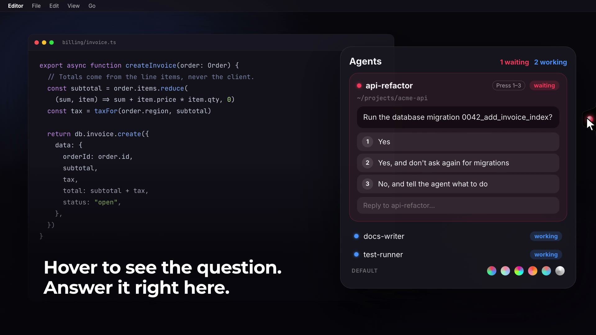

# Herdr-Glow

Your coding agents, one glance away.

Herdr-Glow puts a small light on the right edge of your Mac screen. The light shows the state of your herdr agents. Hover over it to answer a waiting agent without a terminal switch.

**[Website and demo video →](https://siddhartpai.github.io/Herdr-Glow/)**

[](https://siddhartpai.github.io/Herdr-Glow/)

## The light

| Color | Meaning |
|-------|---------|
| Blue  | Agents are working. Nothing needs you. |
| Red   | An agent waits for an answer. |
| Green | A job is done. Hover for the summary. |
| Grey  | herdr is not running. |

## Features

- The panel shows the question that a waiting agent asks, with one button for each option.
- Press 1–9 to answer, or type a free-text reply.
- A finished agent shows a short summary of its work.
- Click a card to open that agent's pane in herdr.
- The light shows on every Space and over full-screen apps.
- Six palettes: Default, Pastel, Neon, Sunset, Ocean and Mono.

## Install

1. Download `Herdr-Glow-0.1.1-macos.zip` from the [latest release](https://github.com/siddhartpai/Herdr-Glow/releases/latest).
2. Unzip it and move `Herdr-Glow.app` to `/Applications`.
3. Run this command in Terminal. The app is not notarized by Apple, so macOS blocks it until you remove the quarantine flag.
   ```sh
   xattr -cr /Applications/Herdr-Glow.app
   ```
4. Open the app. The light appears on the right edge of your main screen.

### Build from source

1. Clone the repository.
   ```sh
   git clone https://github.com/siddhartpai/Herdr-Glow.git
   cd Herdr-Glow
   ```
2. Build the app. The script puts `Herdr-Glow.app` in `~/Applications`.
   ```sh
   scripts/bundle.sh
   ```
3. Open the app.
   ```sh
   open ~/Applications/Herdr-Glow.app
   ```

## Requirements

- macOS 14 or later
- A Swift 6 toolchain (Xcode or the Command Line Tools)
- herdr running. The app connects to `$HERDR_SOCKET_PATH`, or to `~/.config/herdr/herdr.sock`.

## Development

```sh
swift test
```

The demo video source is in `video/demo`. It is a [HyperFrames](https://hyperframes.heygen.com) composition with mock agent data. The website is in `docs/`.

## License

MIT
